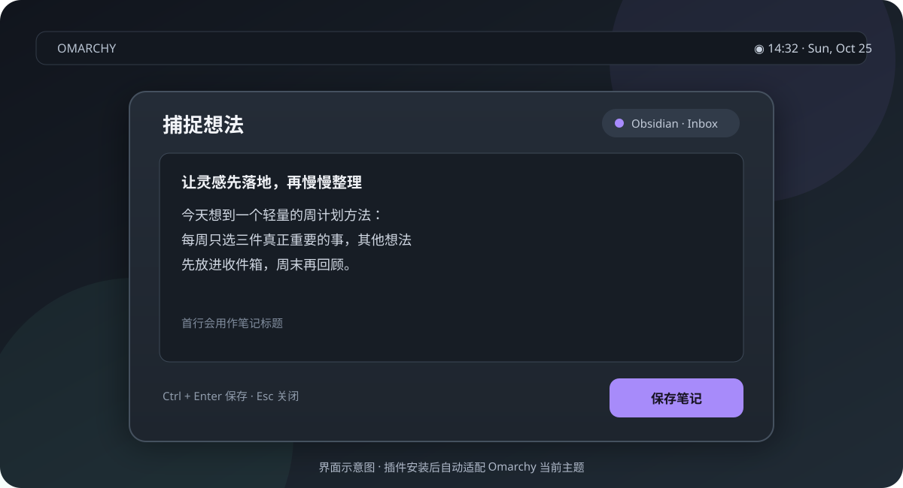
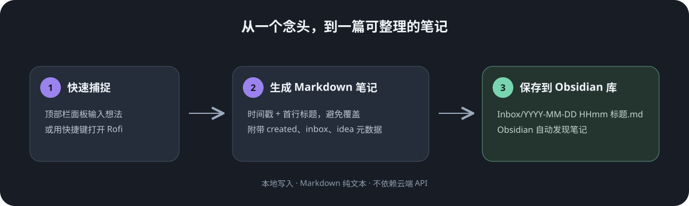

# Omarchy Obsidian Capture

从 Omarchy 顶部栏记录想法，直接保存到 Obsidian 库中的 Markdown 文件。输入多行文字，按 **Ctrl + Enter**，随后在 Obsidian 中继续整理。



*界面示意图；实际面板使用当前 Omarchy 主题。*



每次保存创建一个独立笔记：首个非空行成为标题，正文保留输入内容，并附上创建时间、`inbox` 和 `idea` 标签。同名文件会自动加序号，避免覆盖已有笔记。

## 安装

需要支持 `KeyboardPanel` 的 Omarchy shell 和 Python 3：

```bash
omarchy plugin add https://github.com/chivopic/omarchy-obsidian-capture --enable
```

也可以从本地项目目录安装，便于开发：

```bash
# 先查看将要修改的位置
python3 scripts/install-local

# 将本仓库链接到 Omarchy 插件目录并启用顶部栏入口
python3 scripts/install-local --apply
```

本地安装器会保留已有的栏位配置，并在修改 `shell.json` 前备份。如果配置文件不存在，它会只创建插件链接；请通过 Omarchy 插件设置启用 **Obsidian Capture**。

在 Omarchy 插件设置中填写：

| 设置 | 示例 | 说明 |
| --- | --- | --- |
| Obsidian 库的绝对路径 | `/home/alex/Documents/My Vault` | 已存在的 Obsidian 库目录 |
| 库内笔记文件夹 | `Inbox` | 库内的相对路径；不存在时自动创建 |

## 使用

点击顶部栏的 **✎**，输入想法，按 **Ctrl + Enter** 或点击「保存笔记」。保存成功后面板显示文件名；如果保存期间继续输入，新输入会保留。**Esc** 关闭面板，未保存内容在当前插件实例中保留。

例如输入 `一个想法` 和下一行 `下周试试`，会生成类似：

```markdown
---
title: "一个想法"
created: 2026-10-25T14:32+08:00
tags:
  - inbox
  - idea
---

# 一个想法

一个想法
下周试试
```

## 快捷键与命令行

在运行中的 Omarchy 会话里，可以用以下命令打开原生面板：

```bash
omarchy-shell shell summon io.github.chivopic.obsidian-capture
```

例如，在确认快捷键没有冲突后，可在 `~/.config/hypr/bindings.lua` 添加：

```lua
o.bind("SUPER + SHIFT + N", "记录想法", "omarchy-shell shell summon io.github.chivopic.obsidian-capture")
```

先用 `omarchy menu keybindings --print` 检查快捷键；如果已占用，选择其他组合。快捷键配置依赖你安装的 Omarchy 和 Hyprland 版本。

也可以从管道直接保存，不需要打开面板或 Obsidian：

```bash
printf '读到一个有趣的点子\n下周试试看。' | scripts/obsidian-capture \
  --stdin --vault "$HOME/Documents/My Vault" --folder Inbox
```

CLI 还支持 `--capture` 和可选的 Rofi `--prompt`；运行 `scripts/obsidian-capture --help` 查看参数。

## 设计与隐私

笔记写入本地 UTF-8 Markdown，不需要网络或 AI 服务。`vault` 目录必须存在，目标文件夹必须位于该目录内。文件名包含日期、时间和标题，重复时追加序号。

目前只创建新笔记；自动追加到每日笔记、模板、目标切换和自动 Git 同步还没有实现。与 QuickAdd、Obsidian URI 及 Omarchy 同类工具的对照见[竞品比较](docs/COMPARISON.md)。

## 开发与验证

```bash
python3 -m unittest discover -s tests -p 'test_*.py' -v
python3 tests/run_qml_smoke.py
```

自动化检查使用临时库。QML 检查需要安装 Omarchy shell UI kit 和可访问的 Wayland 会话；它加载真实组件并验证保存期间的新草稿不会丢失。图中面板为示意图，不是实际桌面截图。

项目采用 [MIT 许可证](LICENSE)。
